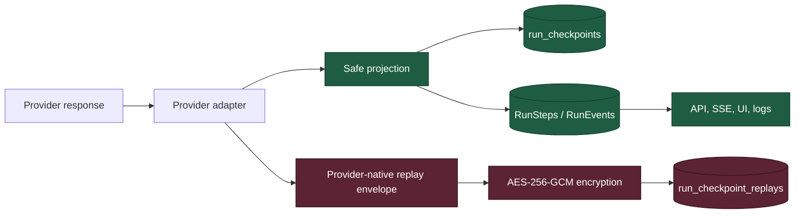
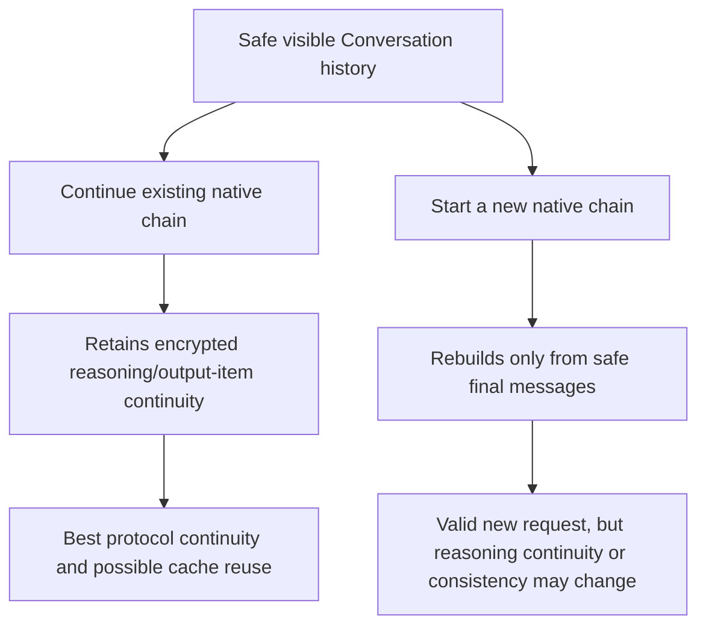
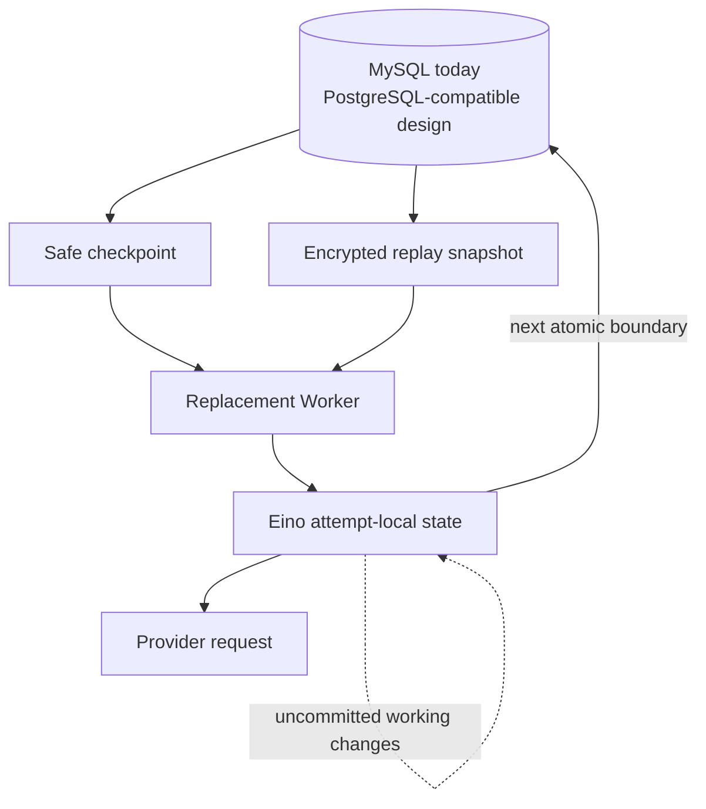
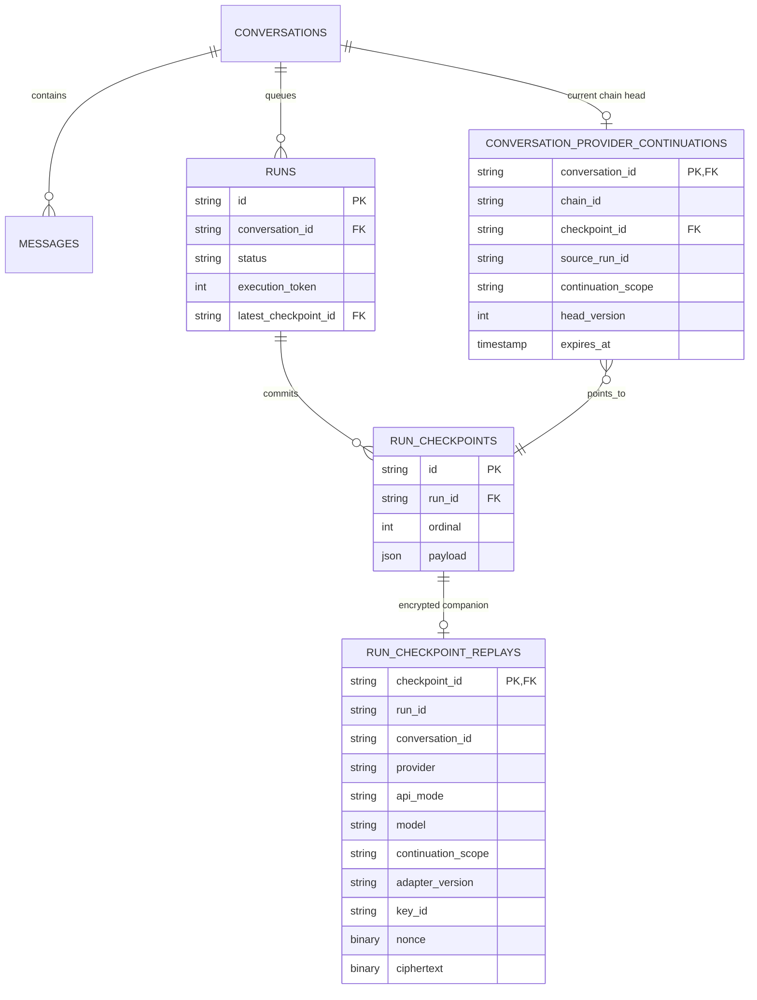
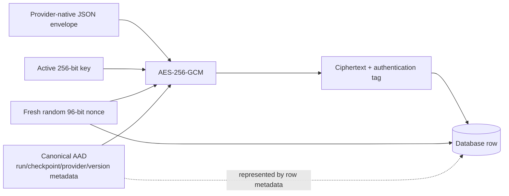
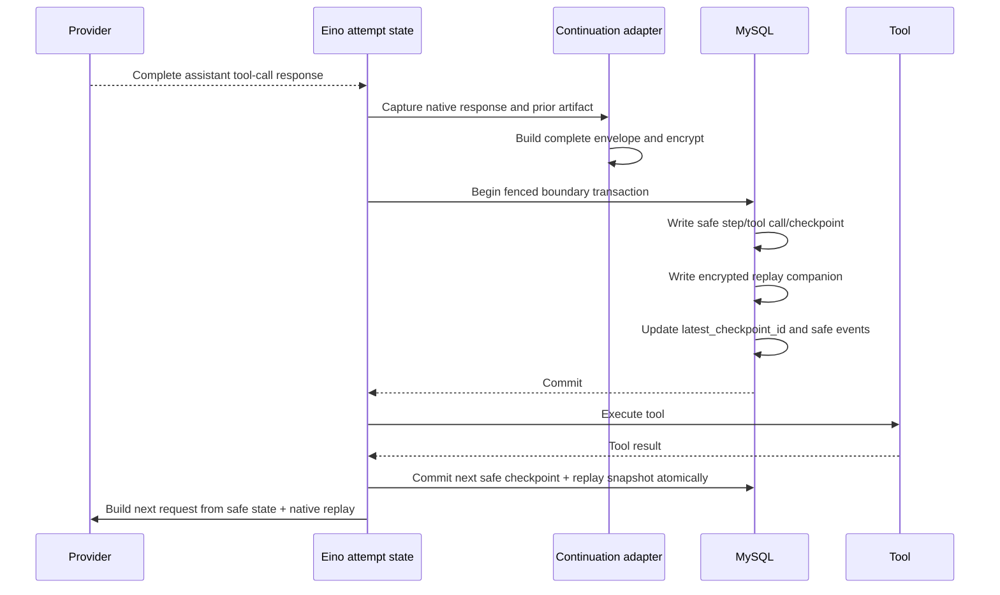
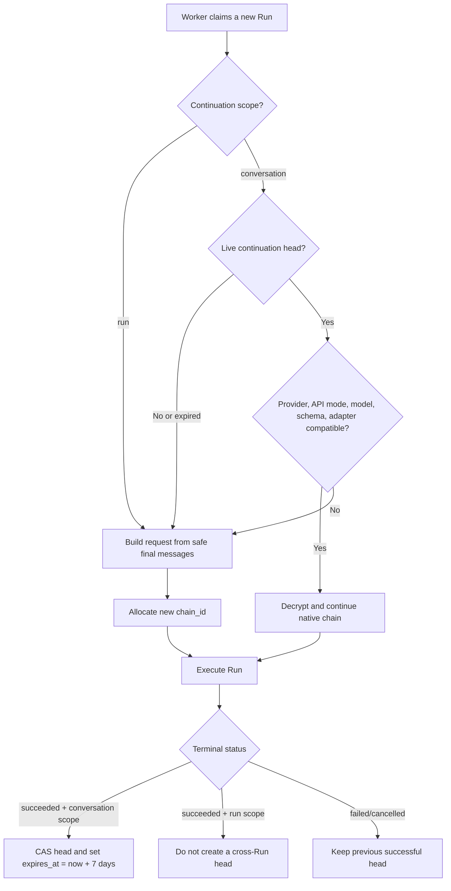
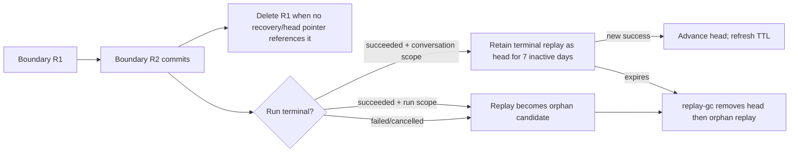
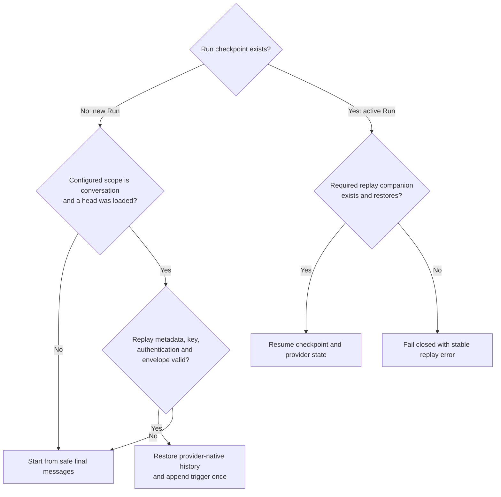
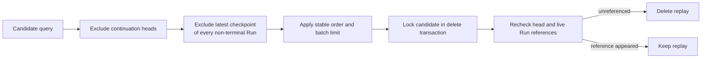

# Provider Continuation, Reasoning Replay, and Worker Failover

## Purpose

This document explains why reasoning-capable provider APIs need durable protocol
state, how that state differs from the platform checkpoint, and how a replacement
Worker resumes without depending on process memory. The approved implementation
contract is defined in
[Durable Provider Continuation Replay Design](../superpowers/specs/2026-08-09-provider-continuation-replay-design.md).

The central rule is:

> The platform checkpoint is the recovery root, and encrypted provider replay is
> its required companion when a provider continuation contract applies.

Reasoning is never a trace feature. It is confidential provider protocol state.

## Why this state exists

“Reasoning content” is not one portable field. Depending on provider, model, and
API mode, continuation may require readable text, opaque encrypted data, signed
blocks, positioned signatures, tool-call IDs, or complete output items. Removing
those fields can make the next tool-loop request invalid or cause the model to
start a semantically different chain.

| Provider and mode | Native continuation data | Relevant replay behavior |
| --- | --- | --- |
| OpenAI Responses reasoning models | Reasoning output items, encrypted content, function-call items, and item identity | With application-managed history, resend the required response output items; the platform uses `store: false` rather than a provider-held response chain. |
| Anthropic Messages with extended/adaptive thinking | Complete thinking blocks and signatures | Thinking blocks must remain complete and unmodified when returning tool results in the same tool-use turn. |
| Moonshot Kimi preserved thinking modes | Assistant `reasoning_content` and native tool calls | Preserve the provider-native assistant messages according to the selected model/mode contract. |
| DeepSeek thinking/tool modes | Assistant `reasoning_content` for modes that require it | Preserve it when the live model contract requires tool-loop replay. Some ordinary multi-turn modes instead instruct clients to omit historical reasoning. |
| Google Gemini function calling | `thought_signature` in its original response part | Retain the signature and its native position; do not move or normalize it. |

An “OpenAI-compatible” endpoint only describes part of the transport shape. It
does not guarantee that reasoning fields, validation rules, or lifecycle behavior
match OpenAI.

The configured `deepseek-v4-pro` endpoint illustrated this distinction during the
2026-08-09 verification: it returned streamed `reasoning_content`, but a direct
tool continuation with that field removed still returned HTTP 200. That endpoint
therefore did not enforce the documented-looking field in the probed mode. This
does not prove that replay can be discarded for other DeepSeek endpoints, modes,
or future versions. Compatibility is validated per provider/model/API mode.

## Chat Completions, Responses, and providers

An API mode defines the request/response protocol. A provider is the vendor or
serving backend that implements a protocol. They are related, but not equivalent:
one provider can offer several API modes, and several providers can implement an
OpenAI-shaped Chat Completions endpoint with different private-field rules.

| Dimension | Chat Completions | OpenAI Responses |
| --- | --- | --- |
| Primary structure | Ordered `messages` with assistant `tool_calls` and tool-result messages | Typed input/output items, including reasoning, function calls, and function-call outputs |
| Typical state model | Client resends message history; `reasoning_content` is usually a provider extension | Provider-managed response chain or application-managed item history |
| This platform's mode | Current Eino OpenAI-compatible adapter | Native Responses adapter |
| Durable native replay | Complete assistant messages and provider extensions needed by the exact endpoint | Complete required output items, including encrypted reasoning items |
| Provider-side storage | Not relied upon | Disabled with `store: false`; `previous_response_id` is not the recovery authority |
| Best fit | Broad OpenAI-compatible provider support and existing Eino ReAct integration | OpenAI reasoning models whose continuation contract is item-based |

The adapter selection key is effectively
`provider + api_mode + model + adapter_version`. A provider label alone cannot
decide replay behavior. Anthropic Messages and Gemini GenerateContent require
their own native adapters even if a gateway also exposes an OpenAI-compatible
facade, because signed thinking blocks and thought signatures cannot safely be
reconstructed from a generic `reasoning_content` field.

## Why discarding reasoning can appear to work today

The current Eino ADK execution has two different lifetimes that are easy to
confuse:

1. Inside one healthy `Runner.Run` invocation, Eino's ReAct state holds the raw
   assistant response in process memory. The next loop iteration can therefore
   see native reasoning even though the platform's event/checkpoint projection
   removes it.
2. The platform hook/stream-consumer path sanitizes reasoning before safe state is
   persisted or exposed. The durable checkpoint does not recreate Eino's private
   in-memory copy after process loss.

Consequently, a healthy Worker can complete several tool iterations while the
durable checkpoint remains insufficient for a strict provider. On takeover, a
new Eino invocation has only the sanitized checkpoint unless an encrypted replay
companion exists.

Even after takeover, omission may appear to work when the exact provider endpoint
does not validate the field, recomputes reasoning, accepts a visible-history
restart, or the test never produced replayable reasoning. Success in those cases
is endpoint behavior, not evidence that Eino or the Worker durably cached the
original content. A provider compatibility experiment must assert that reasoning
was actually returned and record whether the exact endpoint accepts or rejects
the stripped request. The hardened production Worker does not run that unsafe
experiment: it fails closed before issuing an incomplete active-Run request.

## The two data planes



The safe plane contains user-visible messages, sanitized assistant content,
pending tool calls, iteration/control state, and allowlisted trace data. The
private plane contains exact native continuation artifacts. The private plane is
never projected into RunEvents, RunSteps, HTTP responses, browser payloads,
metrics labels, or ordinary logs.

## What is a provider continuation chain?

A provider continuation chain is the ordered native state that allows a later
request to continue the provider's prior computation. It is not:

- a persistent TCP/HTTP connection;
- Worker affinity;
- an Eino object that lives forever;
- necessarily a provider-side session; or
- the visible Conversation message list.

The platform owns the chain when it stores native output locally and sends it
back on later requests. OpenAI Responses is configured with `store: false`, so no
`previous_response_id` is required for correctness.

Replay lifetime is adapter-declared because provider contracts differ:

| Continuation scope | Meaning |
| --- | --- |
| `run` | Native replay is required inside the current tool loop and for same-Run Worker takeover, but is not reused by the next Run. |
| `conversation` | The successful terminal replay is additionally promoted to a seven-day Conversation continuation head. |

This does not introduce an optional recovery mode. With
`reasoning_replay=required`, either scope must have a valid artifact whenever an
active Run resumes. Scope controls only whether a successful terminal artifact
continues across Runs. OpenAI Responses uses `conversation`; Anthropic tool-use
thinking and provider modes that require historical reasoning removal use `run`;
preserved-thinking-across-turns modes use `conversation` only when verified for
that exact endpoint/model/mode.

Two chains can display the same visible Conversation while differing internally:



An expired or incompatible chain does not delete the Conversation. It only means
the next request starts from safe visible history without old private artifacts.

## State ownership and precedence



The durable database boundary always wins during recovery. Eino's
`ChatModelAgentState`/`compose.ProcessState` is an in-memory working copy for the
current invocation. Eino exposes an optional external `CheckPointStore`, but the
project does not configure it, and its ADK checkpoint path is not the platform's
normal per-ReAct-boundary persistence contract.

Therefore:

1. During a healthy attempt, Eino may hold raw reasoning that has not yet been
   projected into the safe checkpoint.
2. At a durable boundary, the platform commits safe checkpoint plus encrypted
   replay in one transaction.
3. If the Worker dies, all later uncommitted Eino state disappears.
4. The replacement Worker reconstructs a fresh Eino working state from the last
   committed checkpoint and replay.
5. The old Eino state has no priority and no path to the replacement Worker.

Configuring a second Eino checkpoint store would create two durable authorities
that might advance at different times. The design deliberately avoids it.

## Database tables and their distinct jobs



| Table | What it answers | What it must not become |
| --- | --- | --- |
| `messages` | What safe final user/assistant history belongs to the Conversation? | A store for hidden reasoning or cancelled partial output used as model history |
| `runs` | Which execution is queued/running/terminal, and which Worker attempt owns it? | Provider protocol storage |
| `run_checkpoints` | What safe iteration, pending-tool, and control state resumes this Run? | A container for replay ciphertext in its JSON payload |
| `run_checkpoint_replays` | What exact encrypted native state accompanies this checkpoint? | A public trace table or a chain of deltas |
| `conversation_provider_continuations` | Which successful terminal replay is the current cross-Run head? | A duplicate copy of encrypted replay data |

The replay table is independent from the checkpoint JSON so database permissions,
retention, migrations, and accidental API selection can be controlled separately.
The head table is needed because `runs.latest_checkpoint_id` answers same-Run
recovery, while a later Run needs the latest successful replay across Runs.

## What ciphertext, nonce, and AAD mean



The plaintext is the serialized complete provider-native replay snapshot. The
ciphertext is that plaintext transformed by AES-256-GCM plus its authentication
tag. It is opaque binary data (`BLOB`/`LONGBLOB` in MySQL, `BYTEA` in PostgreSQL),
not another readable reasoning field.

A nonce is a number used once with a particular key. It is not secret and is
stored beside the ciphertext. Every replay encryption gets a fresh random
96-bit nonce. Reusing the same key/nonce pair can destroy AES-GCM confidentiality
and authenticity, so nonce generation is part of the security invariant.

Additional authenticated data (AAD) is not encrypted, but any change to it makes
authentication fail. The platform uses canonical, versioned AAD to bind the
ciphertext to its Run, checkpoint, Conversation, provider, API mode, model,
continuation scope, artifact/adapter versions, algorithm, and key ID. Moving
ciphertext to another row or changing routing metadata therefore cannot decrypt
successfully.

Version 1 stores JSON without compression:

```text
provider-native JSON -> AES-256-GCM -> nonce + ciphertext
```

The row still records `encoding=json` and `compression=none`, allowing a future
implementation to add a versioned `gzip` or `zstd` decoder. Compression, if ever
used, occurs before encryption.

## Why Workers need active and historical keys

New rows are encrypted with the active key. Rows written before a rotation still
refer to their old `key_id`, so Workers need historical decryption keys until
those rows expire or are re-encrypted.

```mermaid
sequenceDiagram
    participant D as Deployment
    participant W as Workers
    participant DB as Replay rows

    D->>W: Distribute K2 as readable; keep K1
    W->>DB: Existing K1 rows remain decryptable
    D->>W: Set active key ID = K2
    W->>DB: Encrypt all new rows with K2
    W->>DB: Decrypt K1 or K2 according to row key_id
    D->>DB: Wait for GC or re-encrypt remaining K1 rows
    D->>W: Remove K1 only after no referenced K1 row remains
```

The database stores only `key_id`, nonce, ciphertext, and routing/version
metadata. Key bytes come from a Worker deployment secret. Startup fails if the
active ID is absent or any configured AES key is not exactly 32 bytes. A future
KMS/HSM resolver can implement the same key-ID contract.

The deployment accepts either the legacy single-key `REPLAY_ENCRYPTION_KEY` for
local development or a production keyring through
`REPLAY_ENCRYPTION_ACTIVE_KEY_ID` plus `REPLAY_ENCRYPTION_KEYS` (a JSON object
mapping key IDs to base64-encoded 32-byte keys).

## Native envelope, not Eino serialization

The decrypted artifact has a small common envelope and adapter-owned native
items:

```json
{
  "schema_version": 1,
  "provider": "deepseek",
  "api_mode": "chat_completions",
  "model": "deepseek-v4-pro",
  "continuation_scope": "run",
  "adapter_version": "deepseek-chat-completions/v1",
  "items": [
    {
      "role": "assistant",
      "content": null,
      "reasoning_content": "provider-native value",
      "tool_calls": [{ "id": "call_...", "type": "function", "function": {} }]
    }
  ]
}
```

Persisting Eino structs would couple durable data to one Go dependency's field
names, custom marshal behavior, and upgrade schedule. A provider-native envelope
instead lets the adapter preserve unknown/private fields and reconstruct the
provider request directly. The common envelope supports routing and compatibility;
it does not pretend that Claude signatures, Gemini parts, Responses output items,
and Chat Completions messages are interchangeable.

When building a request, the adapter merges safe history and native replay. A
native assistant item replaces its sanitized projection where appropriate; it is
not appended as a duplicate assistant response.

## Normal tool-loop commit



The platform never claims a safe checkpoint is durable while its required replay
row is missing. For `reasoning_replay=required`, either both commit or neither
does.

External tool idempotency remains necessary. A Worker can die after an external
effect but before its result boundary commits; replay persistence solves provider
continuity, not the distributed-systems impossibility of inferring whether an
untracked external side effect happened.

## Worker failover

```mermaid
sequenceDiagram
    participant W1 as Worker A
    participant DB as Durable state
    participant W2 as Worker B
    participant P as Provider

    W1->>DB: Commit checkpoint C7 + replay R7 (token 4)
    W1--xW1: Process crashes
    Note over DB: Lease expires; C7 and R7 remain atomic
    W2->>DB: Claim same Run (token 5)
    W2->>DB: Load latest checkpoint C7 and replay R7
    W2->>W2: Validate metadata, key ID, AAD, GCM tag, envelope
    W2->>W2: Rebuild fresh Eino state
    W2->>P: Continue with exact provider-native state
    W1-->>DB: Any stale token-4 write is rejected
```

For a required active Run, missing replay, an unknown key, failed authentication,
or an incompatible adapter is not a reason to reconstruct from sanitized history.
The Run fails closed with a safe stable error code.

If the crash occurs during streaming before a complete provider response exists,
there is no partial replay artifact to persist. The replacement resumes from the
previous complete boundary and repeats that model call. No partial stream is
treated as provider-native continuation state.

## Queue, Steer, and continuation-head behavior

The current platform allows several non-terminal Runs to be queued, but only the
Run whose `queue_seq` equals `conversations.next_executable_run_seq` is executable.
For `conversation` scope, this serializes provider-chain advancement without
rejecting follow-up messages. For `run` scope, every queued Run starts a new
provider-native chain when it becomes executable.

```mermaid
sequenceDiagram
    participant Q as Conversation queue
    participant H as Continuation head
    participant R1 as Run 1
    participant R2 as Run 2 (queued)

    Note over R1,H: conversation-scope example
    R1->>H: Read head H0 when claimed
    R2->>Q: Created while Run 1 executes; do not pin a head
    R1->>H: Success: CAS H0 -> H1 and refresh 7-day TTL
    Q->>R2: Run 2 becomes executable
    R2->>H: Read current H1 at claim time
    R2->>H: Success: CAS H1 -> H2
```

A failed or cancelled Run does not advance the head. Steer cancels the running and
queued Runs, creates a replacement Run, and that Run later reads the last
successful head. Cancelled partial assistant Messages have `status=cancelled` and
the existing history query selects only `status=final`, so partial output does not
re-enter future model context.

## Same chain versus new chain



The reset branch is allowed only when starting a new Run. During same-Run takeover,
the current artifact is part of the committed execution state; incompatibility or
loss fails closed rather than silently changing the computation.

## Retention and compaction

Seven days of inactivity is the project retention period for a successful
Conversation continuation head. It is a product/security decision, not a
provider-wide industry constant. Provider services and orchestration frameworks
use different lifecycles: some keep state server-side for a documented period,
some keep it only in application memory, and production workflow frameworks such
as LangGraph support durable stores with configurable TTL and keep-latest cleanup.

The project uses both immediate compaction and scheduled GC:



Rules:

- Never expire the latest recovery replay of an active/resumable Run.
- Keep only the latest committed snapshot when older snapshots are unreferenced.
- For `conversation` scope, keep the successful terminal replay while the
  continuation head references it.
- For `run` scope, never create a head; successful terminal replay becomes an
  orphan candidate after completion.
- Refresh expiry after each successful head advance.
- Do not advance the head on failure or cancellation.
- After expiry, delete private replay state but retain safe Conversation messages.
- Run an idempotent `replay-gc` command as a Kubernetes CronJob in small batches.
- Before each delete, recheck active Run status, `latest_checkpoint_id`, and live
  head references.

Using an application maintenance command rather than MySQL Event Scheduler keeps
the behavior portable to PostgreSQL and testable with the same business rules.

## Database portability

The design is portable because correctness depends on ordinary transactions,
row locking, foreign/unique keys, binary large-object columns, timestamps, and
table-level role grants supported by both MySQL and PostgreSQL.

Implementation differences stay in migrations/infrastructure:

| Capability | MySQL | PostgreSQL |
| --- | --- | --- |
| Encrypted bytes | `BLOB`/`LONGBLOB` | `BYTEA` |
| Claim/GC concurrency | Transactional row locks | Transactional row locks |
| Role isolation | Database/table `GRANT` | Roles and table `GRANT` |
| Scheduled cleanup | Kubernetes `replay-gc` CronJob | Same CronJob |

Replay code must not rely on MySQL Event Scheduler, JSON extraction for native
artifacts, MySQL-only triggers, or vendor-specific upsert semantics without a
storage abstraction and equivalent PostgreSQL implementation.

Database capabilities are wired through role-specific DSNs:
`API_MYSQL_DSN`, `WORKER_MYSQL_DSN`, `MIGRATION_MYSQL_DSN`, and
`MAINTENANCE_MYSQL_DSN`. They fall back to `MYSQL_DSN` in local development.
Production infrastructure must assign separate credentials and grants; the DSN
selection alone does not create database users or grant permissions.

## Failure and observability model

| Safe code | Meaning |
| --- | --- |
| `provider_replay_missing` | Required companion row is absent |
| `provider_replay_key_unavailable` | Key ID is not resolvable from the Worker keyring |
| `provider_replay_decrypt_failed` | Nonce/AAD/ciphertext authentication failed |
| `provider_replay_incompatible` | Provider or artifact/adapter contract cannot resume this active Run |

Logs may record Run/checkpoint IDs, provider routing metadata, adapter version,
key ID, ciphertext byte size, and one of these classifications. They must never
record plaintext, raw reasoning, encrypted reasoning items, key bytes, nonce plus
ciphertext dumps, or raw provider responses.

## Verification matrix

### Recovery decision after hardening

The checkpoint boundary, rather than the presence of Eino memory, determines
whether replay failure can reset safely:



This asymmetry is safe because a new Run has no in-progress tool decision. Its
visible final history is a valid new provider-native chain. An active Run may
already contain an assistant tool call whose provider state must remain paired
with the next tool result, so resetting would change the execution.

GC uses two layers of protection:



Query-time exclusion guarantees progress when old protected rows exist.
Transaction-time rechecking prevents deletion when a reference appears after
selection.

For every enabled provider/model/API mode, verify all four Worker-loss points:

1. assistant tool-call response committed;
2. external tool finished but result boundary not committed;
3. tool-result boundary committed; and
4. provider stream incomplete.

The replacement must preserve native ordering and tool-call/result pairing,
avoid duplicate effects where the tool idempotency contract supports it, reject
stale Worker writes, and keep reasoning out of all public planes.

The deterministic Chat Completions harness is:

```bash
MODE=baseline ./scripts/ha/test-reasoning-failover.sh
MODE=protected ./scripts/ha/test-reasoning-failover.sh
```

The hardened `baseline` removes the companion and must terminate with
`provider_replay_missing`; it verifies the active-Run fail-closed invariant and
never contacts the provider with stripped state. `protected` must succeed after
takeover and assert that reasoning was actually returned, otherwise it did not
exercise reasoning replay. Historical provider acceptance/rejection experiments
must use an explicitly isolated pre-hardening build, not a production bypass.

## Implementation status

The approved design and its production hardening amendment are implemented.
Replay artifacts use the independent
`run_checkpoint_replays` table; checkpoints contain only the safe projection.
The runtime uses a versioned provider-native envelope, AES-256-GCM keyring/AAD,
typed fail-closed errors, `run|conversation` scope, Responses `store:false`, and
manual Responses output-item replay. Successful terminal boundaries and
Conversation heads commit atomically. The `replay-gc` command is deployed as a
Kubernetes CronJob.

The initial 2026-08-09 pre-hardening HA verification produced these results:

- protected Run `01KZK2KBHZKQEG67XG9YDZHJZ1` resumed on attempt 2 after its
  Worker was force-deleted;
- stripped baseline Run `01KZK2J1CXX8QNQMMF1V8W98WS` also succeeded on attempt
  2, confirming that the configured DeepSeek endpoint accepts omission in the
  tested mode. The production Worker no longer permits this fail-open path; and
- a manual `replay-gc` Job deleted eight unreferenced artifacts, including all
  terminal `run`-scope snapshots for the protected Run, without deleting its
  safe checkpoints.

Historical completed Conversations have no continuation head and start a new
chain after rollout. There were no active Runs requiring migration.

## Sources

- OpenAI, [Model guidance: persisted reasoning and manual history](https://developers.openai.com/api/docs/guides/latest-model)
- OpenAI, [Responses API reference](https://developers.openai.com/api/reference/resources/responses/methods/create)
- Anthropic, [Thinking with tool use](https://platform.claude.com/docs/en/build-with-claude/thinking)
- Moonshot, [Thinking models](https://platform.kimi.ai/docs/guide/use-thinking-models)
- DeepSeek, [Thinking mode](https://api-docs.deepseek.com/guides/thinking_mode) and [reasoning model multi-round conversation](https://api-docs.deepseek.com/guides/reasoning_model)
- Google, [Thought signatures](https://ai.google.dev/gemini-api/docs/generate-content/thought-signatures)
- LangGraph, [Persistence](https://docs.langchain.com/oss/javascript/langgraph/persistence)
