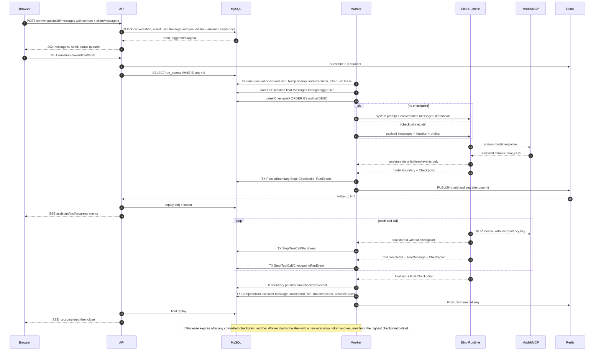

# Agent Platform: Data-Driven Runtime Flow and Table Relationships

> This guide is for engineers reading the project for the first time. It is not a layered architecture overview; it follows one real `Run` through the HTTP request, database rows, Worker, Runtime, Checkpoint, and SSE.
>
> Responsibility boundary: Eino owns Agent/Graph execution, the ReAct loop, and `ToolNode` orchestration; the platform implements `tool.BaseTool` and owns MCP execution adaptation, retries, cancellation, leases, checkpoints, and database persistence. The real data snapshot in this document was read from local `agent_platform` MySQL on 2026-08-01; examples retain only project demo data and the necessary excerpts.

## Start with the right mental model

MySQL is the sole durable source of truth. One user input ultimately produces:

```text
Conversation
  └─ Message(user, seq=N) ──triggers──> Run(queue_seq=N)
                                         ├─ RunStep (an explainable boundary)
                                         ├─ ToolCall (a safe record of one tool invocation)
                                         ├─ RunCheckpoint (recoverable runtime state)
                                         ├─ RunEvent (a replayable SSE event)
                                         └─ Artifact (large object; no local examples yet)
```

The database has **no foreign-key constraints** (`information_schema.key_column_usage` contains no `referenced_table_name`). These relationships are maintained by application code, unique indexes, and transactions. Do not treat `run_id` as a database-enforced FK when reading the code; it is an application-level logical association key.

Redis only publishes a `{runId, seq}` wake-up hint. If it is lost, the API can still replay SSE from `run_events`; Redis does not store Runs, Checkpoints, event payloads, or leases.

## Current database snapshot

| Table | Actual rows | What this data shows |
| --- | ---: | --- |
| `users` | 1 | The MVP demo principal |
| `conversations` | 41 | 40 are soft-deleted and remain in the database |
| `messages` | 129 | User input and final/cancelled assistant messages |
| `runs` | 80 | 47 succeeded, 26 failed, and 7 were cancelled |
| `run_steps` | 277 | Low-frequency execution boundaries for Trace/UI |
| `tool_calls` | 647 | Allowlisted tool invocations and safe summaries |
| `run_checkpoints` | 914 | Complete runtime state used for Worker recovery |
| `run_events` | 6,126 | Source for SSE replay, including high-frequency deltas |
| `artifacts` | 0 | The external large-result mechanism was not triggered by local samples |

### Successful real-world sample used throughout

| Field | Value |
| --- | --- |
| `runs.id` | `01KYE7NKH9YDDQVBSS22ZSA26N` |
| `conversation_id` | `01KYD0XJNJZ7RHE1A8TAS4VBTA` |
| `trigger_message_id` | `01KYE7NKH83FMYWS8N6DST3AEG` |
| Status | `succeeded` |
| `queue_seq` / `attempt` / `execution_token` | `9` / `1` / `1` |
| Start and end time | 2026-07-26 03:32:01.768666 → 03:33:47.285023 UTC |
| `latest_checkpoint_id` | `01KYE7RTKQ4GVKJ6V57CQ1W57W` (ordinal 14) |
| `next_event_seq` | `188`, meaning 187 events with seq `1..187` have been persisted |
| Related rows | 4 `run_steps`, 10 `tool_calls`, 14 `run_checkpoints`, and 187 `run_events` |

The trigger was the conversation's eleventh message: `and what is paxos?`. The sample performs 10 read-only Workspace tool calls and finally writes one assistant Message of 5,799 characters.

## Every table: owner, contents, writers, and readers

| Table | Logical parent and key relationships | Core data and constraints | Primary writer | Primary readers and purpose |
| --- | --- | --- | --- | --- |
| `users` | `conversations.user_id → users.id` | `id`, `team_id`, `display_name` | API `EnsureUser` middleware | API authorization root; currently `demo-user` |
| `conversations` | Multi-turn container for one user | `next_message_seq`, `next_run_seq`, and `next_executable_run_seq` control ordering; `deleted_at` enables soft deletion | API when creating conversations/appending messages; Worker advances the executable sequence after a Run completes | API list and detail views; Worker locks it to advance the queue at completion |
| `messages` | `conversation_id`; assistant rows can also point to `run_id` | `(conversation_id, seq)` and `(conversation_id, client_message_id)` are unique | API writes user Messages; Worker writes assistant Messages when a Run ends successfully or is cancelled | Initial Worker context, API conversation detail, and final message display |
| `runs` | `conversation_id`; `trigger_message_id` uniquely identifies the user Message | `(conversation_id, queue_seq)` is unique; lease, attempt count, `execution_token`, `latest_checkpoint_id`, and `next_event_seq` live here | API creates queued Runs; Worker claims, renews, and completes them | Worker queue/recovery, API snapshot/authorization; all child tables join through `run_id` |
| `run_steps` | `run_id` | `(run_id, step_no)` is unique; stores only explainable, low-frequency boundaries | Worker's `PersistBoundary` | `GET /runs/{id}/trace` |
| `tool_calls` | `run_id`, `step_no` | Globally unique `idempotency_key`; includes arguments and `result_summary`, with optional `artifact_id` | Worker's `PersistBoundary` | Trace/UI and troubleshooting; not the sole recovery-state source |
| `run_checkpoints` | `run_id` | `(run_id, ordinal)` is unique; includes runtime name, schema version, and JSON payload | Produced by Runtime and transactionally written by Worker | A new or takeover Worker restores Runtime state; `runs.latest_checkpoint_id` is a redundant shortcut pointer |
| `run_events` | `run_id` | `(run_id, seq)` is unique; `seq` is allocated atomically from `runs.next_event_seq` | Worker; the cancellation path may also write terminal events | API SSE replay; Redis only signals that a new seq may exist |
| `artifacts` | `run_id`, optionally referenced by `tool_calls.artifact_id` | `content`, `sha256`, `byte_size` | Reserved path for large results | `GET /runs/{run}/artifacts/{artifact}`; the real local database currently has 0 rows |

### Do not confuse the most important sequence numbers

| Field | Scope | Purpose |
| --- | --- | --- |
| `messages.seq` | One Conversation | Chat-history order; Worker loads only final user/assistant messages through the trigger Message |
| `runs.queue_seq` | One Conversation | Run queue order within a conversation; `next_executable_run_seq` decides which Run can be claimed |
| `run_events.seq` | One Run | SSE cursor; clients resume with `Last-Event-ID` or `?after=` |
| `run_checkpoints.ordinal` | One Run | Monotonic version for recoverable state; the Worker currently reads the highest ordinal |

## From user input to a queued Run: the first transaction

`POST /api/v1/conversations/{conversationID}/messages` first validates that `clientMessageId` is a ULID, parses follow-up mode, and then calls `CreateUserMessageAndRunForUser`.

Within one local MySQL transaction:

1. `SELECT ... FOR UPDATE` locks the conversation.
2. It looks up an existing Message by `(conversation_id, client_message_id)` for client-retry idempotency. If one exists, it follows `runs.trigger_message_id` and returns the original Run.
3. If mode is `steer`, it cancels active Runs in that conversation first.
4. It inserts one `messages` row: `role=user`, `status=final`, and `seq=next_message_seq`.
5. It inserts one `runs` row: `trigger_message_id=message.id`, `queue_seq=next_run_seq`, `status=queued`, and `next_attempt_at=now`, and pins the Agent/Skills versions.
6. It increments the conversation's `next_message_seq` and `next_run_seq`.

As a result, a Message and its Run never normally appear in a partially written state. See [conversations.go](../../backend/internal/store/conversations.go) and the [conversations.go HTTP handler](../../backend/internal/httpapi/conversations.go).

## Worker: what it queries, how it joins data, and how it acquires execution rights

The Worker polls `runs` and, within one transaction, uses `FOR UPDATE SKIP LOCKED` to find:

```sql
status = 'queued'
OR (status = 'running' AND lease_expires_at < now)
```

It also requires `next_attempt_at <= now` and `runs.queue_seq = conversations.next_executable_run_seq`. A successful claim updates:

- `status = running`;
- `attempt = attempt + 1`;
- `execution_token = execution_token + 1`;
- `lease_owner` and `lease_expires_at`;
- `started_at`.

`execution_token` is a fencing token: every subsequent Step, ToolCall, Checkpoint, RunEvent, and terminal write locks or updates using `(run.id, execution_token, status=running)`. Once the lease expires, an old Worker cannot overwrite the newer Worker even if it wakes up later.

`Worker.Execute` then proceeds in order:

1. Read `runs.cancel_requested_at`.
2. Call `LoadRunExecution(runID, token)`, which reads the current Run and final user/assistant Messages in the same conversation where `seq <= triggerMessage.seq`.
3. Call `LatestCheckpoint(runID)`: `run_checkpoints WHERE run_id=? ORDER BY ordinal DESC LIMIT 1`.
4. Renew the lease every 10 seconds.
5. Call `runner.Run(inputMessages, checkpoint, emit)`.

`runs.latest_checkpoint_id` is updated every time, but the current recovery query does **not** read by that ID: it reads by descending ordinal. The field is a convenient navigation/diagnostic pointer, not the sole basis for query correctness.

## Runtime: how state is produced, persisted, restored, and removed

### New Run versus recovered Run

| Situation | Runtime starting state |
| --- | --- |
| No Checkpoint | Final conversation messages from `system prompt + LoadRunExecution`, with `iteration=0` |
| Checkpoint exists | Validate `runtime_name=eino-react` and `state_schema_version=1`, parse the payload, and restore `iteration`, messages, and ordinal; do not append conversation history again |

The current root checkpoint payload structure is:

```json
{
  "iteration": 1,
  "messages": [
    {"role": "system", "content": "..."},
    {"role": "user", "content": "..."},
    {"role": "assistant", "content": "", "tool_calls": [{"id": "call_...", "function": {"name": "file_read", "arguments": "{...}"}}]},
    {"role": "tool", "tool_call_id": "call_...", "tool_name": "file_read", "content": "{...full tool result...}"}
  ]
}
```

Checkpoint #1 in the real sample contains 12 messages. Its last message is an assistant message with six `file_read` calls. Checkpoint #7 already contains six tool results, and its final `file_read` content is 3,519 characters. Checkpoint #14 contains 25 messages, has `iteration=4`, and ends in the final answer. The payload grows from 5,974 bytes to 48,974 bytes.

### When a Checkpoint is created

After Runtime completes an assistant output segment, it adds the assistant message to state and immediately creates a Checkpoint:

- When the assistant selects tools, the checkpoint stores the assistant message containing `tool_calls` before those tools are invoked.
- When each tool completes, it appends `schema.ToolMessage(result.Content, callID, name)` to state and creates a checkpoint.
- When the assistant has no tool calls, it stores a final-answer checkpoint.

The sample's 14 checkpoints can therefore be understood as four model boundaries, including the final answer, plus ten tool completions. A tool start does not create a checkpoint, and neither does every streaming token.

If recovery finds that the last message is an assistant message with `tool_calls`, Runtime executes calls that lack a tool result before returning to the model. This is the recovery point for the case where the model has decided which file to read but the Worker crashes before the tool runs. The platform gives each tool call a `runID:toolCallID` idempotency key, but the overall semantic remains at-least-once; it does not promise absolute exactly-once behavior for external side effects.

### Data that is removed or downgraded

| Original data | Destination | Reason |
| --- | --- | --- |
| Assistant `ReasoningContent` and reasoning-related `Extra` fields | Cleared or filtered before checkpoint creation; excluded from events, logs, and API responses | Reasoning content must not be persisted or exposed |
| Ordinary `Content` on an assistant message with tool calls | Cleared before storage | The message semantically requests tools and should not mix in ordinary answer text |
| High-frequency assistant tokens | Become batched `assistant.delta` `run_events`, not Steps or Checkpoints | Avoid write amplification; deltas are not recoverable state |
| Full tool result | Runtime tool message for recovery; Trace keeps only `tool_calls.result_summary` | Recovery needs full model context; the UI should not push large payloads repeatedly |
| Oversized independent result | Designed to live in `artifacts`, referenced by `tool_calls.artifact_id` | The real database has 0 rows, so the local sample has not used this path |

If middleware performs summarization/reduction, it synchronizes rewritten messages back into checkpoint state before the next model call. Later checkpoints store the compressed model-visible state; they do not rewrite historical `messages` rows or existing trace records.

## How one Runtime boundary writes several tables

When a non-delta `RuntimeEvent` reaches the Worker, the Worker first flushes the delta buffer and then calls `PersistBoundary`. The transaction proceeds as follows:

1. Lock the running `runs` row with the execution token.
2. Upsert `run_steps` (the same `step_no` can be updated from tool-started to tool-completed).
3. Save `tool_calls` if the event involves a tool.
4. Insert `run_checkpoints` and update `runs.latest_checkpoint_id` if the event contains a checkpoint.
5. Insert one or more `run_events`, allocating sequential `seq` values from `runs.next_event_seq` and incrementing that counter.
6. Only after commit, issue Redis `PUBLISH {runId, seq}`.

The sample makes this observable: the first `tool.started` is seq 4, immediately followed by `progress.updated` at seq 5 and `tool.completed` at seq 6. Tool completion adds a ToolCall, a Checkpoint, and an event together. There are 159 `assistant.delta` events but only four `run_steps`, showing that streaming text does not amplify checkpoint/step writes.

## Terminal state, cancellation, and failure

After Runtime returns normally, the Worker's `CompleteRun` performs one transaction:

1. Lock the Run and Conversation.
2. On success, insert `messages(role=assistant,status=final,run_id=...)`; on cancellation, it may insert partial assistant text with `status=cancelled`; on failure, it inserts no assistant Message.
3. Update `runs.status`, clear the lease, write `finished_at`, and optionally write a terminal error.
4. Insert `run.completed`, `run.cancelled`, or `run.failed`.
5. Advance `conversations.next_executable_run_seq` so the next Run in that conversation's queue can be claimed.

The real failed sample `01KYE79346RYJRBCRS7GSAXW83` has no checkpoint, only `run.failed` at seq 1 and `terminal_error_code=runtime_error`. The real cancelled sample `01KYE7J7KYDJHTKSMBDP13189A` already has checkpoints; after it receives a cancellation request, it ends with `run.cancelled` at seq 43 and retains a cancelled partial assistant message of 781 characters.

## API/SSE: events are not state, and events are replayable

After a browser connects to `GET /api/v1/runs/{runID}/events`:

1. The API obtains the cursor from `Last-Event-ID` first, with `?after=` as a fallback.
2. It subscribes to Redis channel `agent-platform:run-events:{runID}` first.
3. It immediately calls `ListRunEvents(runID, seq > cursor ORDER BY seq)` and renders each row as SSE `id/event/data`.
4. On a Redis hint or every 15-second heartbeat, it replays from MySQL again.
5. It closes the connection on `run.completed`, `run.failed`, or `run.cancelled`.

Redis messages are therefore only signals to query the database. SSE disconnection, API restart, or brief Redis unavailability do not erase MySQL seq values; the client simply continues from the last seq it saw.

## Complete sequence: success, recovery, and SSE together



## Shortest code-reading path

1. [Table models](../../backend/internal/model/models.go): field and index intent.
2. [Message/Run creation](../../backend/internal/store/conversations.go): first transaction, idempotency, and queue sequence.
3. [Claim and lease](../../backend/internal/store/runs.go): contention, expired leases, and fencing.
4. [Worker execution](../../backend/internal/worker/worker.go): loading execution/checkpoint state, emitting/persisting boundaries, and completing the Run.
5. [Runtime checkpoints](../../backend/internal/runtime/eino_react.go) and [ADK event mapping](../../backend/internal/runtime/adk_runner.go): when state is produced and sanitized.
6. [Persistence transactions](../../backend/internal/store/execution.go): `PersistBoundary`, `AppendRunEvents`, and `CompleteRun`.
7. [SSE replay](../../backend/internal/httpapi/sse.go): MySQL replay is authoritative; Redis only wakes readers.

## Practical read-only troubleshooting queries

When inspecting the complete related state for a Run, start with `runs.id`:

```sql
-- 1) Run, trigger message, and latest checkpoint pointer
SELECT id, status, attempt, execution_token, trigger_message_id,
       latest_checkpoint_id, next_event_seq, terminal_error_code
FROM runs WHERE id = :run_id;

-- 2) Actual recovery point (implementation queries ordinal, not latest_checkpoint_id)
SELECT id, ordinal, runtime_name, state_schema_version,
       JSON_EXTRACT(payload, '$.iteration') AS iteration,
       JSON_LENGTH(payload, '$.messages') AS message_count, created_at
FROM run_checkpoints WHERE run_id = :run_id ORDER BY ordinal DESC LIMIT 1;

-- 3) Source of truth for UI/event replay
SELECT seq, type, safe_payload, created_at
FROM run_events WHERE run_id = :run_id ORDER BY seq;

-- 4) Trace and tool idempotency key
SELECT step_no, tool_name, status, idempotency_key, result_summary
FROM tool_calls WHERE run_id = :run_id ORDER BY step_no, created_at;
```

Interpret these queries together with lease fields: if `execution_token` has changed, any uncommitted in-memory state in the old Worker is no longer allowed to write. If a checkpoint is committed, a new Worker must recover from it rather than reconstruct model state from SSE deltas or trace data.
